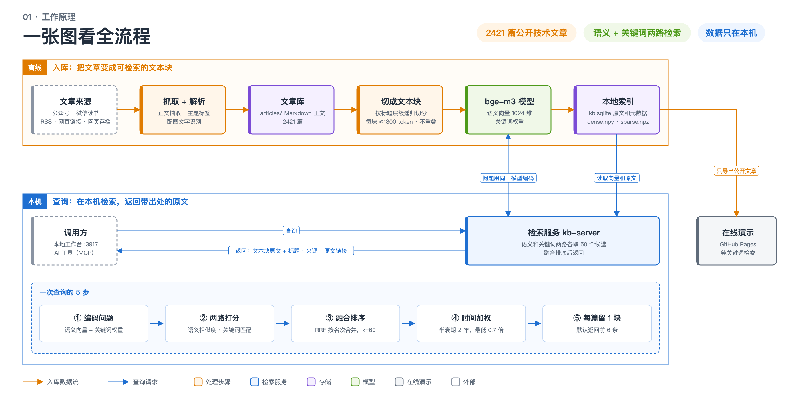
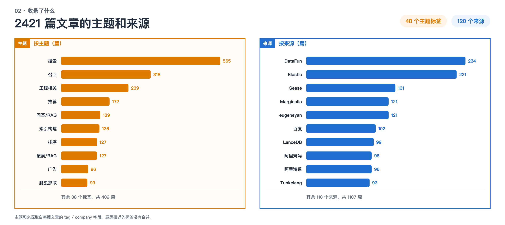

# search-knowledge-base

收录搜索、推荐、检索增强生成（RAG）方向公开技术文章的本地知识库：抓取文章 → 切成文本块 → 两路检索 → 返回带出处的原文。

**[在线演示](https://hulu204.github.io/search-knowledge-base/)** · [文章目录](catalog.md) · [按主题](catalog/by-topic.md) · [按来源](catalog/by-source.md)

## 工作原理



搜索结果就是入库时存下的文本块原文，搜索时不会再切分，也不会生成摘要。

## 两种用法

|  | 在线演示（GitHub Pages） | 本地完整版 |
| --- | --- | --- |
| 检索方式 | 纯关键词检索 | 语义向量 + 关键词权重，两路融合排序 |
| 文章数量 | 2402 篇，切成 25838 个文本块 | 仓库内 2421 篇，可继续添加 |
| 全文阅读 · 本地工作台 · 接入 AI 工具 | 无 | 有 |
| 运行条件 | 浏览器打开即可 | Python、Node、[bge-m3](https://huggingface.co/BAAI/bge-m3)（约 2GB） |

本地工作台只能在本机访问，文章数据不会离开你的电脑。

## 收录了什么

`articles/` 共 **2421** 篇，48 个主题标签，120 个来源机构。



完整清单见[目录](catalog.md)。

语料起点是 [Doragd/Algorithm-Practice-in-Industry](https://github.com/Doragd/Algorithm-Practice-in-Industry)，之后又补充了公开网页和公众号技术文章。版权归原作者，这里只做检索演示，请通过每篇文章的 `url` 访问原文。

## 本地快速开始

```bash
# 1. 安装依赖，并把 bge-m3 模型下载到 models/bge-m3/
python3 -m pip install -e '.[collection,indexing,service]'

# 2. 用仓库内的文章建立检索索引
python3 -m sgt_kb build-index

# 3. 启动本地工作台，浏览器打开 http://localhost:3917
cd workbench && npm ci && cd ..
python3 -m sgt_kb start-workbench
```

添加单篇公开文章：

```bash
python3 -m sgt_kb ingest-url 'https://www.elastic.co/search-labs/blog/hybrid-search-elasticsearch'
python3 -m sgt_kb build-index
```

所有命令的格式都是 `python3 -m sgt_kb 命令名`，安装后也可以简写为 `sgt-kb 命令名`。旧命令对照见[迁移说明](docs/CLI-MIGRATION.md)。

## 仓库结构

```text
sgt_kb/
├── collection/   抓取和解析文章
├── indexing/     入库、切块、导出在线演示数据
├── retrieval/    检索打分
└── service/      本地服务和 AI 工具接入
workbench/        本地工作台前端
docs/             在线演示网站
articles/         文章正文（Markdown）
figures/          配图的文字识别结果和说明
catalog/          主题与来源目录
```

仓库里不包含：向量模型、配图原图（约 881MB）、数据库和检索索引（用 `build-index` 自行生成）、任何登录信息和密钥。

## 更多

<details>
<summary><b>接入 AI 工具（MCP）</b></summary>

在支持 MCP 协议的 AI 工具里，把启动命令设为 `python3 -m sgt_kb kb-server`（工作目录选本仓库）。接入后 AI 可以搜索文章（`kb_search`）、读取全文（`kb_get_doc`）、查看配图（`kb_get_figures`）和查看统计（`kb_stats`）。

需要补充本地背景资料时，复制 `extra-docs/local-context.example.md` 为 `local-context.md`。

</details>

<details>
<summary><b>自动抓取新文章</b></summary>

- RSS 订阅：`python3 -m sgt_kb rss-poll`
- 网页存档网站（Wayback Machine）里的历史文章：`python3 -m sgt_kb wayback-wechat`
- 微信公众号后台（可选）：登录信息只放在 `.wechat_mp_auth.json`，这个文件已设为不提交到 git。

</details>

<details>
<summary><b>更新在线演示的数据</b></summary>

导出只需要 Python 自带的库。它以只读方式打开数据库，只导出公开仓库 `articles/` 里有的文章，不复制数据库，也不重新切块。

```bash
# 从线上数据库导出
python3 -m sgt_kb export-pages --db /path/to/kb.sqlite --output-dir docs --require-production-counts

# 或者用别人已导出的 JSON 文件生成
python3 -m sgt_kb export-pages --input /path/to/prod-export/ --output-dir docs --require-production-counts

# 在本机预览在线演示
python3 -m http.server 8000 --directory docs
```

当前导出了 2402 篇、25838 个文本块。数据库里 `extra-docs/` 的 20 篇和 1 篇不在公开仓库的文章没有导出。为了打开快，网页分三步按需加载：先加载检索目录，再加载搜索词对应的索引，最后只加载命中结果的原文。

数据格式、校验方法和历史版本说明见 [STORED-EXPORT.md](docs/STORED-EXPORT.md)。

</details>

<details>
<summary><b>运行测试</b></summary>

```bash
python3 -m unittest discover -s tests -v
node --test tests/*.test.mjs
```

</details>

## 许可证

代码采用 MIT 许可证。`articles/` 与 `figures/` 内容版权归原作者，仅供检索演示。
