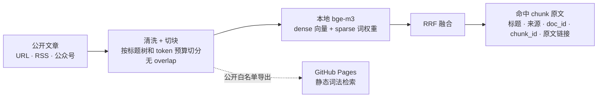
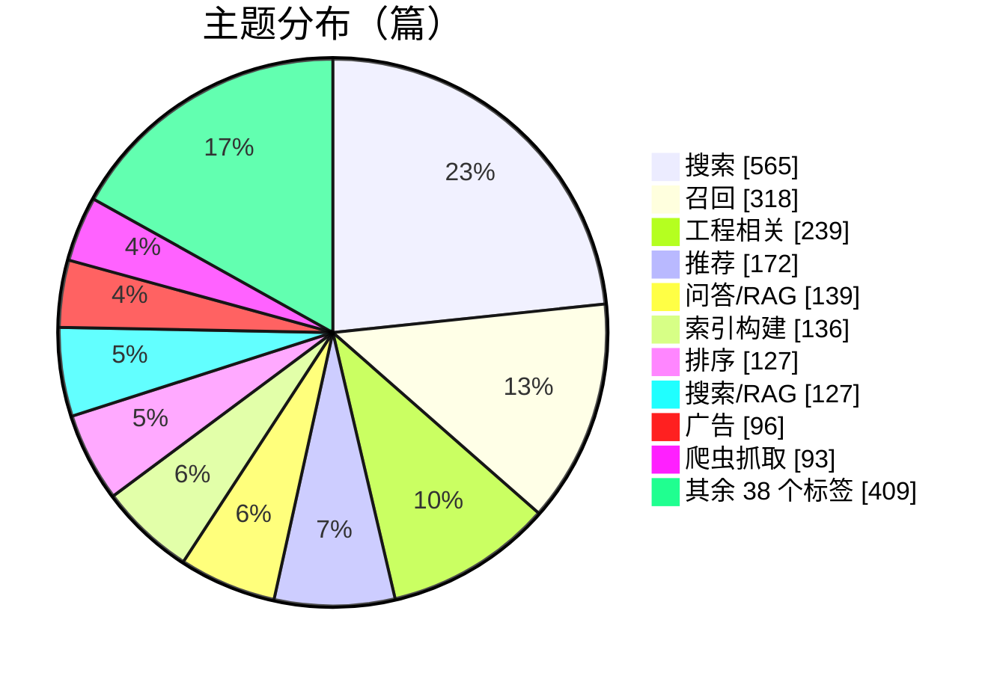
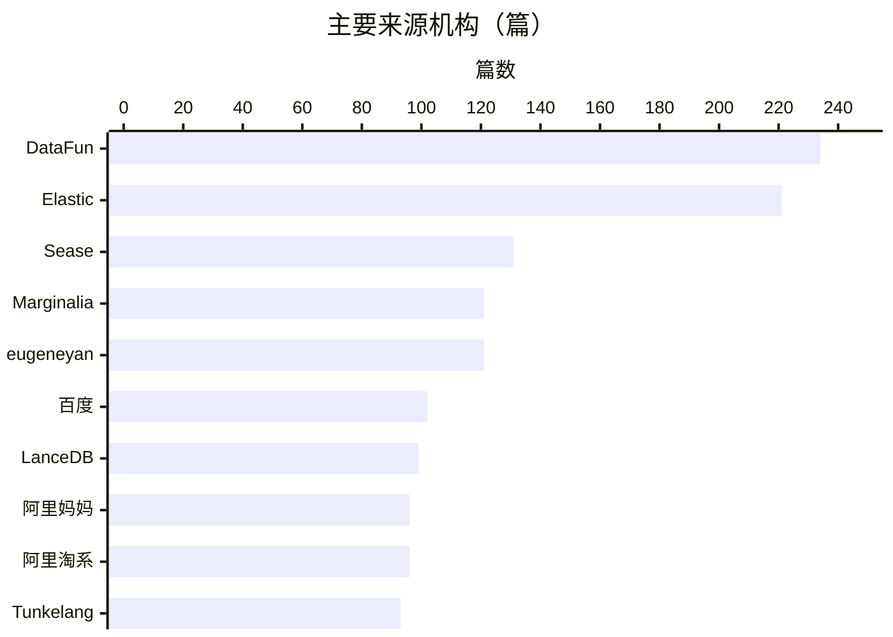

# sgt-kb

搜索 / 推荐 / RAG 公开技术文章的本地知识库：爬取 → 切块 → 混合检索 → 带引用返回。

**[在线演示](https://hulu204.github.io/sgt-kb/)** · [文章目录](catalog.md) · [按主题](catalog/by-topic.md) · [按来源](catalog/by-source.md)

## 工作原理



结果直接展示入库时存储的 chunk 原文，查询时不再切片，也不生成摘要。

## 两种用法

|  | 在线演示（GitHub Pages） | 本地完整版 |
| --- | --- | --- |
| 检索 | 静态词法检索 | bge-m3 dense + sparse，RRF 融合 |
| 语料 | 2402 篇 / 25838 块 | 仓库内 2421 篇，可继续入库 |
| 全文阅读 · 工作台 · MCP | — | ✓ |
| 需要 | 浏览器 | Python、Node、[bge-m3](https://huggingface.co/BAAI/bge-m3)（约 2GB） |

本地工作台只绑定 loopback，语料留在本机。

## 语料

`articles/` 共 **2421** 篇，48 个主题标签，120 个来源机构。





标签和机构取自 frontmatter 的 `tag` / `company`，未合并近义项。完整清单见[目录](catalog.md)。

语料起点是 [Doragd/Algorithm-Practice-in-Industry](https://github.com/Doragd/Algorithm-Practice-in-Industry)，之后补充了公开网页和公众号技术文。版权归原作者，这里只做检索演示，请通过每篇文章的 `url` 访问原文。

## 本地快速开始

```bash
# 1. 安装依赖，并把 BAAI/bge-m3 放到 models/bge-m3/
python3 -m pip install -e '.[collection,indexing,service]'

# 2. 用仓库内文章构建索引
python3 -m sgt_kb build-index

# 3. 启动工作台 → http://localhost:3917
cd workbench && npm ci && cd ..
python3 -m sgt_kb start-workbench
```

单条入库公开链接：

```bash
python3 -m sgt_kb ingest-url 'https://www.elastic.co/search-labs/blog/hybrid-search-elasticsearch'
python3 -m sgt_kb build-index
```

所有命令都是 `python3 -m sgt_kb COMMAND`，安装后也可用 `sgt-kb COMMAND`。旧命令对照见[迁移说明](docs/CLI-MIGRATION.md)。

## 仓库结构

```text
sgt_kb/
├── collection/   采集、解析、队列
├── indexing/     入库、切块、Pages 导出
├── retrieval/    检索评分
└── service/      MCP 与本地 HTTP 服务
workbench/        本地工作台前端
docs/             GitHub Pages 站点
articles/         文章正文（Markdown）
figures/          配图 OCR / 说明 sidecar
catalog/          主题与来源目录
```

不在仓库里：embedding 模型、配图原文件（约 881MB）、SQLite / 向量索引（用 `build-index` 生成）、任何登录态和密钥。

## 更多

<details>
<summary><b>MCP</b></summary>

把 MCP 启动命令设为 `python3 -m sgt_kb kb-server`（工作目录为本仓库），提供 `kb_search`、`kb_get_doc`、`kb_get_figures`、`kb_stats`。

需要本地上下文时，复制 `extra-docs/local-context.example.md` 为 `local-context.md`。

</details>

<details>
<summary><b>持续采集</b></summary>

- 公开 RSS：`python3 -m sgt_kb rss-poll`
- Wayback 历史页：`python3 -m sgt_kb wayback-wechat`
- 微信公众号后台（可选）：凭据只写在被 gitignore 的 `.wechat_mp_auth.json`，不要提交。

</details>

<details>
<summary><b>导出 Pages 检索数据</b></summary>

导出只需 Python 标准库。它只读打开已入库的 SQLite，只导出 `articles/<doc_id>.md` 存在于公开仓库中的文档，不复制数据库、不重新切块。

```bash
# 从生产 SQLite 导出
python3 -m sgt_kb export-pages --db /path/to/kb.sqlite --output-dir docs --require-production-counts

# 或从已导出的 JSONL / JSON 构建分片
python3 -m sgt_kb export-pages --input /path/to/prod-export/ --output-dir docs --require-production-counts

# 本地预览
python3 -m http.server 8000 --directory docs
```

当前导出为 2402 篇 / 25838 块。生产库中的 `extra-docs/`（20 篇）和 1 篇不在公开仓库的文档已排除。浏览器按需加载分片：先加载检索目录，再按查询加载 postings，最后只加载命中结果的原文。

格式、校验哈希和旧 `demo-index.json` 的处理见 [STORED-EXPORT.md](docs/STORED-EXPORT.md)。

</details>

<details>
<summary><b>测试</b></summary>

```bash
python3 -m unittest discover -s tests -v
node --test tests/*.test.mjs
```

</details>

## License

代码为 MIT。`articles/` 与 `figures/` 内容版权归原作者，仅供检索演示。
